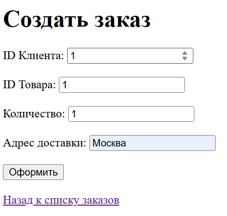
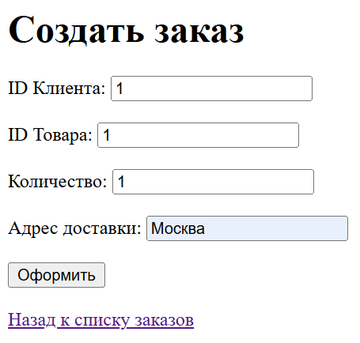

# Отчет по лабораторной работе 5. Разработка и развертывание Web-приложений

## Цель работы
Добавить Web-интерфейс в приложение магазина зоотоваров. Настроить сборку и развертывание проекта в виде WAR-файла на сервере Apache Tomcat 11. Реализовать Java-сервлеты для отображения списка заказов, формы создания заказа, а также REST-сервис для получения информации о продуктах.
## Ход работы

## Вывод
В ходе лабораторной работы в приложение магазина зоотоваров был добавлен Web-интерфейс. Проект был настроен для сборки и развертывания в виде WAR-файла на сервере Apache Tomcat 11. Были реализованы Java-сервлеты для отображения списка заказов и формы создания заказа, а также REST-сервис для получения информации о продуктах. В результате работы была успешно выполнена интеграция Spring-контекста с внешним контейнером сервлетов, настроена корректная передача данных в формате JSON и обеспечена поддержка кодировки UTF-8 для отображения кириллицы.