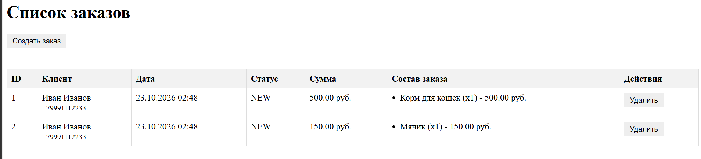
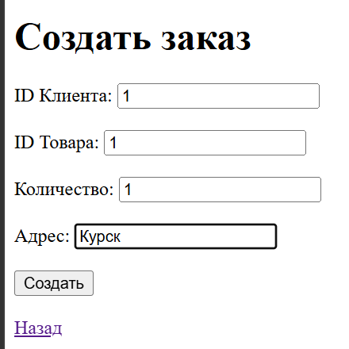
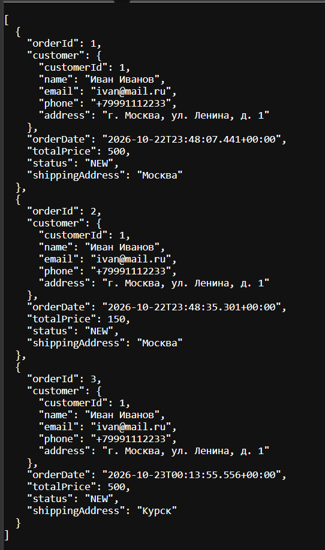

# Отчет по лабораторной работе 6. Разработка Web-приложений с использованием технологии Spring MVC

## Цель работы
Изучить и применить на практике технологию Spring MVC для разработки Web-приложений. Заменить низкоуровневые сервлеты на контроллеры Spring, реализовать полноценный REST API (CRUD) для работы с заказами, а также подключить шаблонизатор Thymeleaf для создания пользовательского Web-интерфейса.
## Ход работы

## Вывод
В ходе лабораторной работы технология низкоуровневых сервлетов была заменена на фреймворк Spring MVC. Был реализован REST API для полноценного CRUD-управления заказами с использованием аннотаций @RestController, а также решена проблема циклической сериализации JSON с помощью Jackson. Для взаимодействия с пользователем подключен шаблонизатор Thymeleaf и реализован Web-интерфейс, позволяющий просматривать, создавать и удалять заказы. Приложение было успешно собрано в WAR-файл и развернуто на сервере Apache Tomcat 11, работа всех эндпоинтов проверена в Postman.

