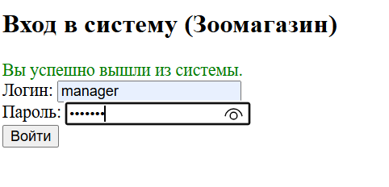
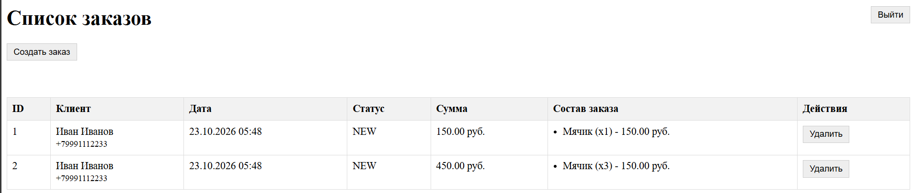
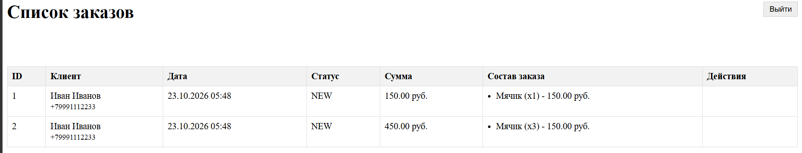

# Отчет по лабораторной работе 7. Spring Security. Basic Authentication

## Цель работы
Настроить безопасность приложения с использованием фреймворка Spring Security. Реализовать ролевой доступ (пользователи user и manager). Настроить аутентификацию через HTML-форму (для Web-интерфейса) и через Basic Authorization (для REST API).
## Ход работы

## Выводы
В ходе лабораторной работы было настроено разграничение прав доступа с помощью Spring Security. Реализована аутентификация по форме для Web-интерфейса и Basic-авторизация для REST API. Настроены роли `USER` (только чтение) и `MANAGER` (полный доступ), что позволило защитить приложение от несанкционированного изменения данных.