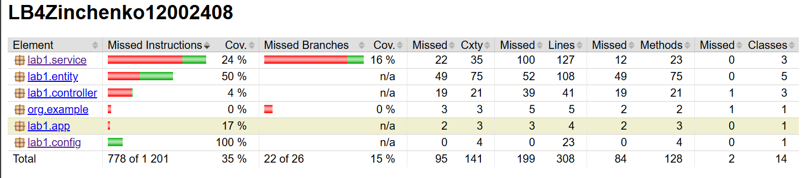
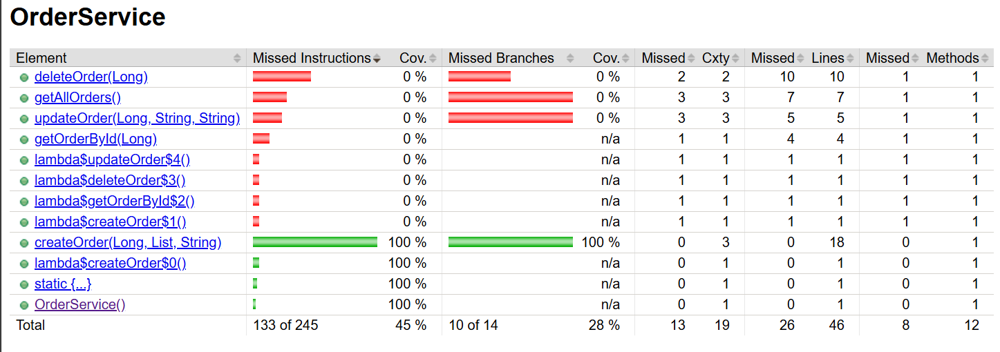

# Отчет по лабораторной работе 8. Основы тестирования

## Цель работы
Настроить инфраструктуру для написания и выполнения Unit- и интеграционных тестов. Освоить фреймворк JUnit 5, библиотеку Mockito и систему анализа покрытия кода JaCoCo. Проверить бизнес-логику сервиса создания заказа.
## Ход работы

## Выводы
В ходе лабораторной работы были освоены практические навыки обеспечения качества кода. Была настроена среда для Unit-тестирования с использованием JUnit 5 и Mockito, что позволило проверить логику сервиса заказов в полной изоляции от базы данных. Написаны интеграционные тесты, подтвердившие корректность взаимодействия сервисного слоя со слоем данных, а также настроена изоляция тестовой среды (H2) от рабочей. Внедрение плагина JaCoCo позволило наглядно оценить степень покрытия кода тестами (метод создания заказа покрыт на 100%).

