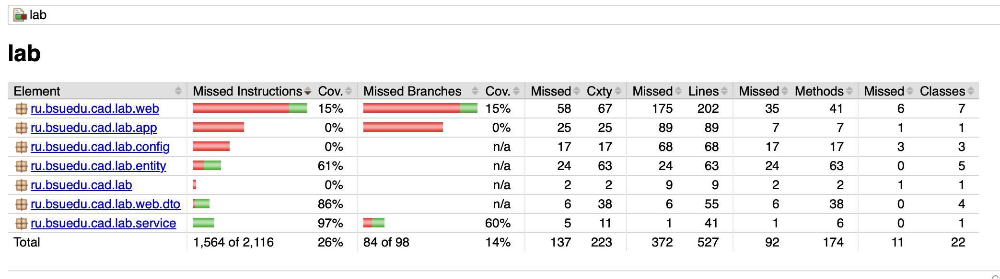

# Лабораторная работа 8 — Основы тестирования

## Описание проекта

  - Добавлены unit-тесты для `OrderService` (`lab/src/test/java/ru/bsuedu/cad/lab/service/OrderServiceTest.java`) — проверяются успешные и негативные сценарии создания/обновления/удаления заказа; внешние зависимости мокаются.

  - Добавлен интеграционный тест `OrderServiceIntegrationTest` (`lab/src/test/java/ru/bsuedu/cad/lab/service/OrderServiceIntegrationTest.java`) — проверяется взаимодействие сервиса с репозиториями и реальной (in-memory H2) базой данных.

  - Добавлена тестовая конфигурация без web-слоя `TestConfig` (`lab/src/test/java/ru/bsuedu/cad/lab/config/TestConfig.java`) для поднятия только JPA и сервисов в интеграционных тестах.

  - В `build.gradle.kts` подключены зависимости для тестирования и плагин JaCoCo; добавлена задача `jacocoTestReport` для генерации HTML-отчёта покрытия.

  

  1. Выполните тесты и соберите отчёт JaCoCo из корня проекта `lab`:

  ```bash
  cd lab
  ./gradlew test jacocoTestReport
  ```

  2. Откройте HTML-отчёт в браузере:

  ```bash
  open build/reports/jacoco/test/html/index.html
  ```

  Или откройте файл `lab/build/reports/jacoco/test/html/index.html` вручную.

  Отчёт показывает покрытие по пакетам и по классам, а также подробности по строкам и методам.

