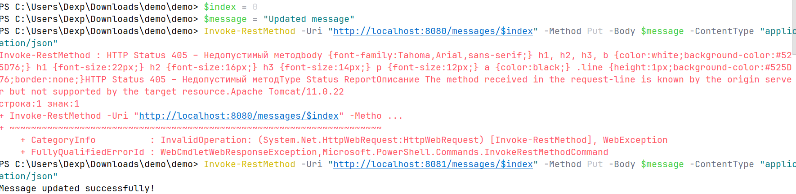
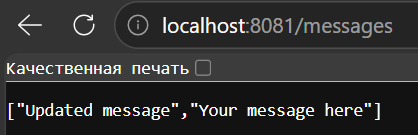
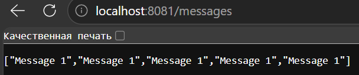
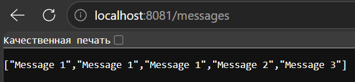
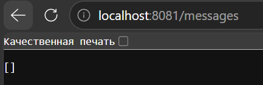

# Лабораторная работа №1. Введение в Spring Boot

## Цель работы
Получить практические навыки работы с фреймворком Spring.

## Ход работы


```powershell
PS C:\Users\Dexp\Downloads\LAB1Zinchenko12002408> $message = "Сообщение 1"
PS C:\Users\Dexp\Downloads\LAB1Zinchenko12002408> Invoke-RestMethod -Uri "http://localhost:8081/messages" -Method Post -Body $message -ContentType "application/json"
Message published successfully! Total messages: 1
PS C:\Users\Dexp\Downloads\LAB1Zinchenko12002408> $message = "Message 1"
PS C:\Users\Dexp\Downloads\LAB1Zinchenko12002408> Invoke-RestMethod -Uri "http://localhost:8081/messages" -Method Post -Body $message -ContentType "application/json"
Message published successfully! Total messages: 2
PS C:\Users\Dexp\Downloads\LAB1Zinchenko12002408> $message = "Message 1"
PS C:\Users\Dexp\Downloads\LAB1Zinchenko12002408> Invoke-RestMethod -Uri "http://localhost:8081/messages" -Method Post -Body $message -ContentType "application/json"                                                                                                                                   
Message published successfully! Total messages: 3
PS C:\Users\Dexp\Downloads\LAB1Zinchenko12002408> $message = "Message 1"
PS C:\Users\Dexp\Downloads\LAB1Zinchenko12002408> Invoke-RestMethod -Uri "http://localhost:8081/messages" -Method Post -Body $message -ContentType "application/json"                                                                                                                                   
Message published successfully! Total messages: 4
PS C:\Users\Dexp\Downloads\LAB1Zinchenko12002408> $message = "Message 1"
PS C:\Users\Dexp\Downloads\LAB1Zinchenko12002408> Invoke-RestMethod -Uri "http://localhost:8081/messages" -Method Post -Body $message -ContentType "application/json"                                                                                                                                   
Message published successfully! Total messages: 5
PS C:\Users\Dexp\Downloads\LAB1Zinchenko12002408> $message = "Message 1"
PS C:\Users\Dexp\Downloads\LAB1Zinchenko12002408> Invoke-RestMethod -Uri "http://localhost:8081/messages" -Method Post -Body $message -ContentType "application/json"                                                                                                                                   
Message published successfully! Total messages: 5
PS C:\Users\Dexp\Downloads\LAB1Zinchenko12002408>
PS C:\Users\Dexp\Downloads\LAB1Zinchenko12002408> $message = "Message 2"
PS C:\Users\Dexp\Downloads\LAB1Zinchenko12002408> Invoke-RestMethod -Uri "http://localhost:8081/messages" -Method Post -Body $message -ContentType "application/json"                                                                                                                                   
Message published successfully! Total messages: 5
PS C:\Users\Dexp\Downloads\LAB1Zinchenko12002408> $message = "Message 3"
PS C:\Users\Dexp\Downloads\LAB1Zinchenko12002408> Invoke-RestMethod -Uri "http://localhost:8081/messages" -Method Post -Body $message -ContentType "application/json"                                                                                                                                   
Message published successfully! Total messages: 5
PS C:\Users\Dexp\Downloads\LAB1Zinchenko12002408> Invoke-RestMethod -Uri "http://localhost:8081/messages" -Method Delete
All messages cleared successfully!
```



## Вывод
В ходе выполнения лабораторной работы олучил практические навыки работы с фреймворком Spring.