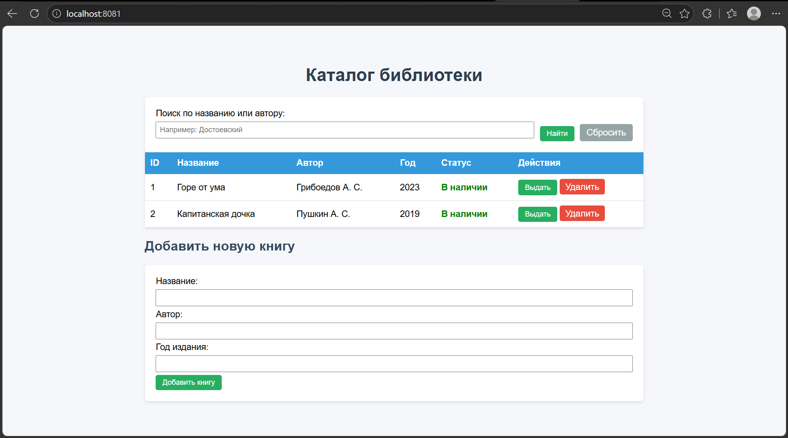
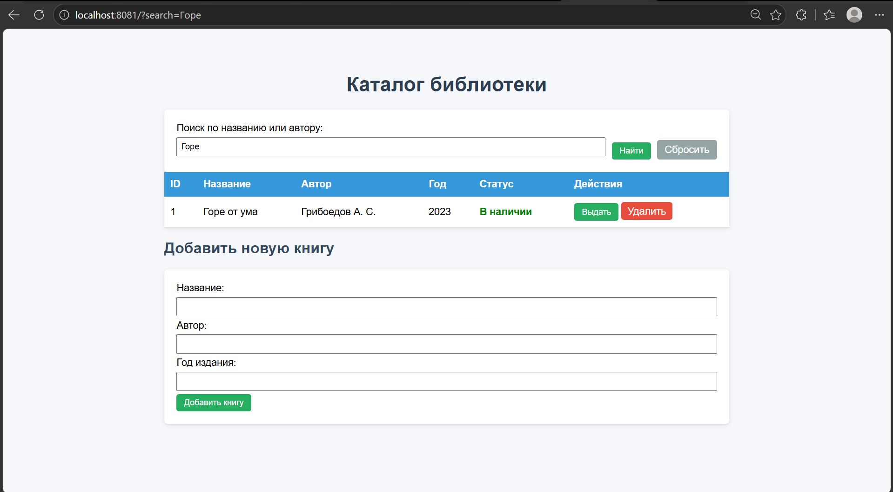
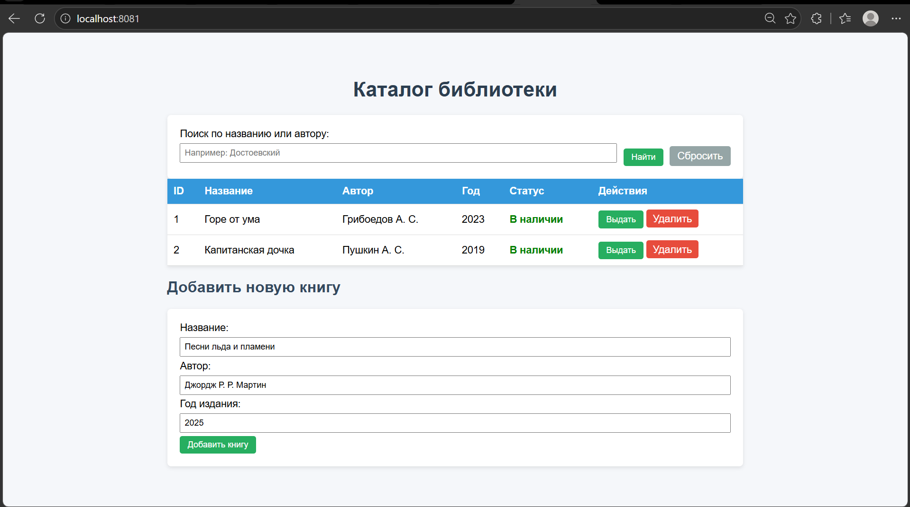
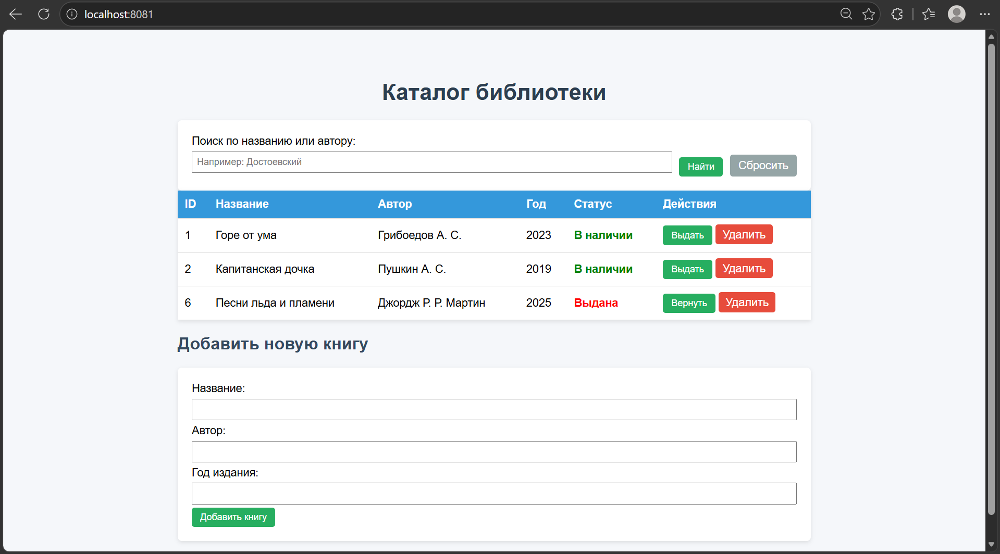
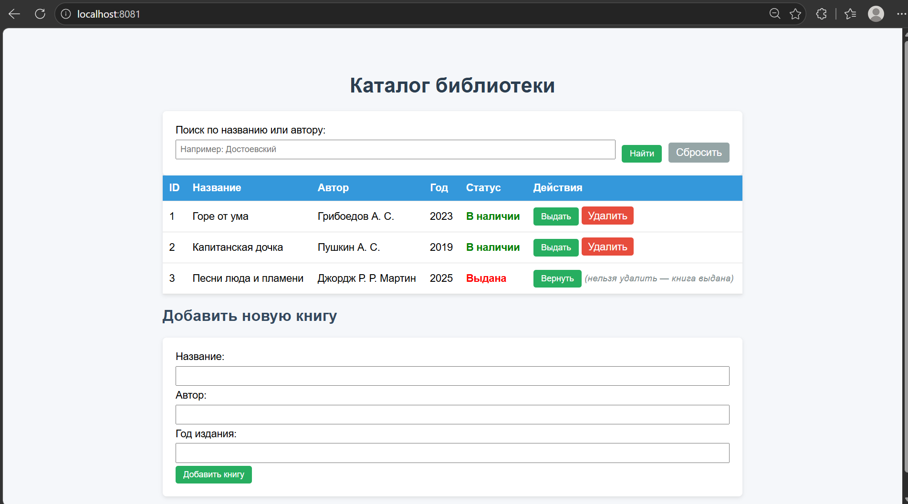
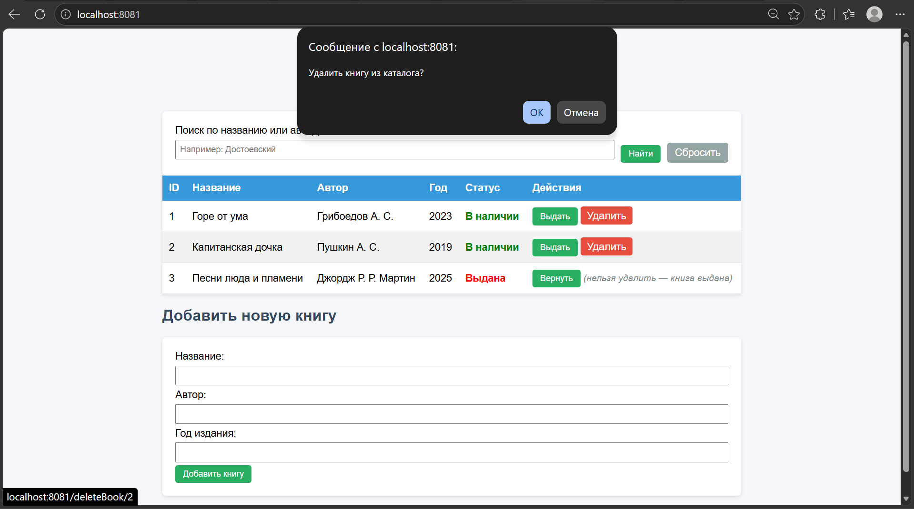
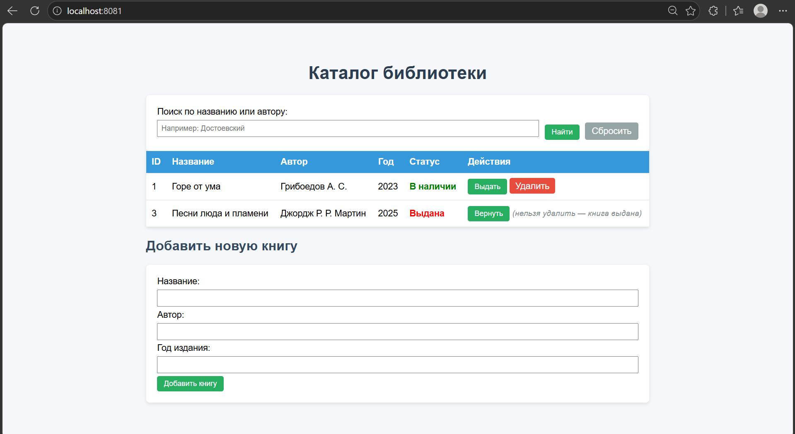

# Лабораторная работа №2. Spring MVC

## Цель работы
Получить практические навыки работы с фреймворком Spring.

## Ход работы

## Вывод
В ходе выполнения лабораторной работы получил практические навыки работы с фреймворком Spring.